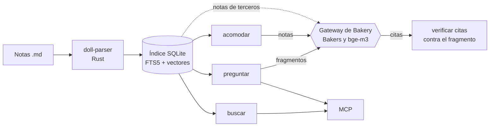

# Arquitectura

Doll indexa notas Markdown en SQLite y las consulta de tres maneras: `buscar` (sin modelo), `preguntar` (con un modelo local y citas verificadas) y `acomodar` (propone dónde va una nota). Los modelos viven en [Bakery](https://github.com/RemiH06/Bakery): Doll no carga ninguno.

## Índice

`doll indexar` lee el corpus de `~/.doll/corpus.toml` y guarda el índice en `~/.doll/<corpus>.db`. Solo reprocesa las notas cuyo hash cambió.

- `doll-parser`, un filtro en Rust, parte cada nota por encabezado y saca sus enlaces y su frontmatter. Cada fragmento guarda ruta, líneas y texto.
- FTS5 busca sin acentos y pesa más el título (5) y el encabezado (3) que el texto (1).
- `tipo`, `estado` y `dominio` salen del frontmatter de cada nota: el código no fija sus valores.
- Un enlace a una nota excluida se tapa como `[[…]]`, en la tabla de enlaces y en el texto del fragmento, para que su nombre no se pueda buscar.
- Con `--sentido`, los fragmentos de notas de terceros también se guardan como vectores, por hash del texto: una nota que no cambia no se vuelve a embeber.

## buscar

1. FTS5 devuelve los fragmentos que coinciden, como máximo 2 por nota, para que una sola nota no llene los primeros lugares.
2. Se agregan hasta 3 notas enlazadas con `[[wikilinks]]` desde la mejor.
3. Con `--tipo` o `--dominio`, filtra por frontmatter. Con `--sentido`, busca por vectores, solo en notas de terceros; sin gateway, regresa a FTS5 sobre esas mismas notas y lo avisa.

## preguntar

1. Recupera como `buscar`. Si la pregunta coincide con una frase de `alcances`, busca solo en esa carpeta.
2. Agrega el resto de la mejor nota, hasta 4000 caracteres.
3. Si la pregunta nombra algo con mayúscula que no aparece en lo recuperado, responde "no encontrado" sin llamar al modelo y dice qué nombres faltaron.
4. Escribe los fragmentos en un archivo temporal y se lo pasa al Baker `doll` (el gateway lee archivos, no texto pegado). El texto de terceros va marcado como no confiable.
5. Cada cita del modelo se busca en el fragmento recuperado; la que no aparece se descarta. Si no sobrevive ninguna, la respuesta es "no encontrado".

Sin gateway, `preguntar` lo dice y entrega los fragmentos.

## acomodar

Solo propone: no escribe en las notas.

- **Notas de una carpeta con tabla de clases** (inspiración): el Baker `clasificador` elige la clase sin ver la que la nota ya trae; los enlaces salen de la tabla.
- **Las demás notas:** carpeta, `tipo`, `estado`, dominio principal, proyecto y enlaces. El modelo lee el título y los primeros 600 caracteres. Las opciones salen del índice. `tipo` y `estado` se toman de la carpeta cuando el 60 % de sus notas comparte valor. Si el 60 % de la carpeta declara su proyecto con `ficha:`, la nota se lee completa y el modelo elige entre los proyectos que ella nombra. Los enlaces se proponen con FTS5.

Todas las notas van en una sola llamada: las otras notas del lote le sirven de contexto al modelo (ver [evaluación](evaluacion.md)).

## Privacidad

- Los índices, la configuración y los sets de evaluación viven en `~/.doll/` (o en `DOLL_HOME`), fuera del repo.
- `~/.doll/log.jsonl` guarda tiempos y conteos, nunca preguntas ni fragmentos.
- `gente/**` y `life/**` quedan fuera de cualquier corpus. `mcp_excluir` oculta notas al MCP, porque lo que entrega el MCP entra a sesiones de otros proyectos.
- No hay servicios externos: el modelo y los embeddings corren en la máquina con Bakery.
